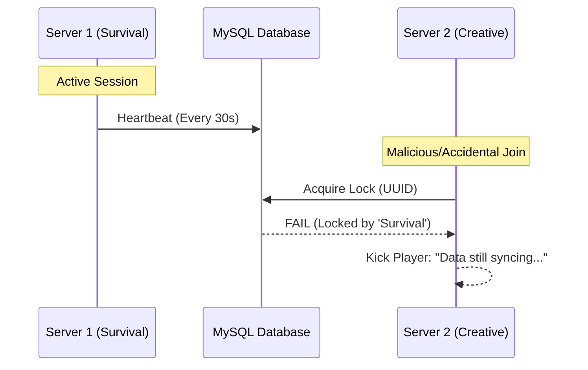
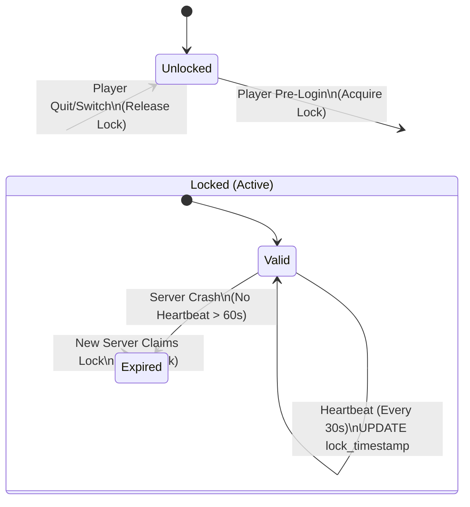

# HMT Sync

[](https://hangar.papermc.io/HMLabs-Gaming/HMTSync)
[](https://www.spigotmc.org/resources/hmtsync.139621/)
[](https://github.com/TitanSMP/HMTSync)


[](https://github.com/TitanSMP/HMTSync/releases)
[](https://hangar.papermc.io/HMLabs-Gaming/HMTSync)

HMT Sync is a robust, high-performance plugin for **PaperMC/Spigot** backends and the **Velocity** proxy.
It synchronizes player data across multiple Minecraft servers, ensuring a consistent experience by
retaining health, hunger, experience, inventory, and much more as players move between linked servers.

> A fork of _MC Data Bridge_, rebranded and maintained for the HMT Network.

---

## Table of Contents

- [Compatibility](#compatibility)
- [Features](#features)
- [Installation](#installation)
- [How It Works](#how-it-works)
- [Configuration](#configuration)
- [Commands](#commands)
- [Permissions](#permissions)
- [Third-Party Integrations](#third-party-integrations)
- [Metrics](#metrics)
- [Important Notes](#important-notes)
- [Documentation](#documentation)

---

## Compatibility

- **Minecraft Version:** `26.3` (built against Paper `26.3.build.42-alpha`)
- **Java:** 25
- **Backend Platforms:** PaperMC (and forks such as Purpur), Spigot/CraftBukkit
- **Proxy Platform:** Velocity 3.1+
- **Folia:** detected at runtime (regionised schedulers are used), though a few admin/backup code paths still rely on the legacy scheduler — see the notes below.

Separate JARs are shipped for each platform:

| JAR                               | Platform                         |
| --------------------------------- | -------------------------------- |
| `hmt-sync-<version>-spigot.jar`   | Paper / Spigot / Purpur backends |
| `hmt-sync-<version>-velocity.jar` | Velocity proxy                   |

The backend and proxy JARs share the same codebase but contain platform-specific plugin metadata
(`plugin.yml` vs. `velocity-plugin.json`).

> **BungeeCord / Waterfall** code exists in the sources but is **not** published as a supported build.

### Platform support detail

- **Paper / Purpur** — fully supported. Paper-only APIs (`PlayerBridge`, `PaperProfileUtils`) are
  isolated and enabled automatically when Paper is detected.
- **Spigot / CraftBukkit** — supported through automatic fallbacks: when Paper is not present the
  plugin falls back to the standard Bukkit `kickPlayer(String)` / `disallow(Result, String)` and
  `BukkitScheduler` paths. Requires an Adventure-enabled server (Spigot/CraftBukkit 1.19+).
- **Folia** — the plugin declares `folia-supported: true` and routes core sync work through a Folia
  region scheduler. However, the `/hmtsync` command handlers, the data-management GUI and the
  automatic database-backup task still use the legacy `Bukkit.getScheduler()` / `BukkitRunnable`,
  which is not available on Folia. Those specific features will not work on Folia yet.

---

## Features

### Core synchronization

- **Proxy-Initiated Saves:** the proxy (Velocity) orchestrates the save process, ensuring a player's
  data is saved from the source server _before_ they connect to the destination server. This removes
  race conditions and prevents data loss/duplication during a server switch.
- **Fully Asynchronous:** all database work runs off the main thread, so a slow database never blocks
  the server tick loop.
- **Robust Locking:** a database-level lock with a monotonic `lock_version` fencing token and an
  automatic timeout guarantees only one server can write a player's data at a time. A heartbeat
  refreshes the lock while the player is online, and a stale lock from a crashed server can be stolen.
- **Version-Independent Item Serialization:** items are serialized via Minecraft's own
  `ItemStack#serializeAsBytes()` (Base64) with an `item-nbt-api` fallback and legacy JSON/NBT/YAML
  deserialization, so stored inventories survive Minecraft updates.
- **HikariCP Connection Pooling:** resilient pooled connections with tuning for network hiccups and
  database restarts.
- **MySQL/MariaDB or SQLite:** use a shared MySQL database for a network, or a local SQLite file.
- **Automatic Schema Management:** tables and columns are created and migrated automatically
  (`auto-update-schema`, default `true`).

### Synced data (granular toggles)

Each component below can be enabled or disabled individually under `sync-data` in `config.yml`:

| Component                                  | Config key                      | Default |
| ------------------------------------------ | ------------------------------- | ------- |
| Health                                     | `health`                        | on      |
| Food level, saturation & exhaustion        | `food-level`                    | on      |
| Experience (total, current, level)         | `experience`                    | on      |
| Inventory                                  | `inventory`                     | on      |
| Armor                                      | `armor`                         | on      |
| Active potion effects                      | `potion-effects`                | on      |
| Ender chest                                | `ender-chest`                   | off     |
| Location (world / x / y / z / yaw / pitch) | `location`                      | off     |
| Advancements + discovered recipes          | `advancements`                  | off     |
| Statistics (all types)                     | `statistics`                    | off     |
| PersistentDataContainer (PDC) values       | `pdc`                           | off     |
| Flight & gamemode                          | `flight-gamemode`               | off     |
| Separate per-gamemode inventories          | `separate-gamemode-inventories` | off     |
| Companions / pets                          | `companions`                    | off     |
| Maps (cross-server map sync)               | `maps`                          | off     |
| Economy (Vault)                            | `economy`                       | off     |
| Playtime (EssentialsX)                     | `playtime`                      | off     |

### Redis hybrid cache (optional)

- A short-lived Redis mirror of the committed player payload lets a server hand data back without an
  immediate SQL read (Redis cache hit `<1 ms` vs. a SQL round trip).
- **SQL stays authoritative.** Redis only mirrors payloads that have already been committed, so a
  cache hit is never newer than the row it mirrors.
- **Locking never moves to Redis.** Distributed locking, the `lock_version` fencing token and all
  durable writes stay on the SQL side; turning the cache on never weakens locking.
- If Redis becomes unavailable the plugin transparently falls back to SQL.
- Keys are namespaced under `hmt:player:<uuid>:*`. See [REDIS_INTEGRATION_GUIDE.md](REDIS_INTEGRATION_GUIDE.md).

### Maps, companions & bridges

- **Cross-server maps:** filled maps keep their artwork and original map id across servers. Optional
  `maps.lock-global-maps` prevents a destination server's map engine from re-scanning terrain and
  overwriting synced map pixels.
- **Companions / pets:** tamed pets and shoulder entities can follow a player across servers
  (`follow`), stay behind and reappear on return (`return`), or be ignored (`untracked`).
- **Economy bridge:** synchronizes Vault-backed balances (authoritative on join — do not combine
  with another cross-server money plugin).
- **Playtime bridge:** synchronizes EssentialsX playtime (cumulative, only ever raised on join).

### Security & identity

- **SHA-256 snapshot checksums:** player data is verified before it is loaded, rejecting corruption
  or tampering (`security.verify-data-integrity`).
- **Salted HMAC identity hashing:** identity records are hashed with `security.seed`, with legacy
  fallback while old rows age out.
- **UUID mismatch logging:** warns when a name joins with a different UUID than recorded
  (`security.log-uuid-mismatches`).
- **Identity modes:** `PREMIUM` keeps UUIDs stable (collisions require a manual `/hmtsync migrate`);
  `HYBRID` allows Cracked→Premium transitions, optionally automated via FastLogin or AuthMe.

### Administration

- **In-game inspector GUI:** overview, inventory and ender-chest views, in read-only or editable mode.
- **Manual lock release** and **data migration** between identities.
- **Server/world blacklist** to exclude specific servers or worlds from synchronization.
- **Internal JSON backups** (`database.backups`) with a clear warning that offsite, external database
  backups (`mysqldump`/`rclone`, managed cloud databases) are strongly preferred.
- **Prometheus metrics exporter** (optional).

---

## Installation

### From a release

1. **Download** the matching JAR from [GitHub Releases](https://github.com/TitanSMP/HMTSync/releases)
   or [Hangar](https://hangar.papermc.io/HMLabs-Gaming/HMTSync).
2. **Backends:** copy `hmt-sync-<version>-spigot.jar` into the `plugins/` folder of **each
   Paper/Spigot server**.
3. **Proxy:** copy `hmt-sync-<version>-velocity.jar` into the `plugins/` folder of your **Velocity
   proxy**.
4. **Configure** `config.yml` on each backend (see below), then restart the proxy and all servers.

### Building from source

Requires **JDK 25** and **Maven 3.9+**.

```bash
# Backend (Paper/Spigot)
mvn clean package -Pspigot
# -> target/hmt-sync-<version>-spigot.jar

# Proxy (Velocity)
mvn clean package -Pvelocity
# -> target/hmt-sync-<version>-velocity.jar
```

Development builds end in `-SNAPSHOT`; release builds use the plain version number.
See [BUILD_GUIDE.md](BUILD_GUIDE.md) for build troubleshooting.

---

## How It Works

HMT Sync takes a **security-first** approach to player state. Instead of simple "save on quit", it
uses a proxy-orchestrated handshake so that data is committed and unlocked before the destination
server is allowed to load it.

### 1. The secure handshake (happy path)

```mermaid
sequenceDiagram
    autonumber
    actor User
    participant P as Proxy (Velocity)
    participant S1 as Source Server
    participant DB as MySQL Database
    participant S2 as Destination Server

    User->>P: /server survival
    par Signal & Switch
        P->>S1: Plugin Message: "SaveAndRelease"
        P->>S2: Connect User
    end

    rect rgb(35, 35, 35)
        Note over S1, DB: Async Save Process
        S1->>DB: UPDATE data... (Save)
        S1->>DB: UPDATE is_locked=0 (Release)
    end

    rect rgb(45, 20, 20)
        Note over S2, DB: Pre-Login Guard
        loop Polling Lock (Max 10s)
            S2->>DB: Attempt Acquire Lock (UPDATE ...)
            alt Lock Acquired
                DB-->>S2: Success
                Note over S2: Break Loop
            else Locked by S1
                DB-->>S2: Fail (Rows = 0)
                S2-->>S2: Sleep 500ms
            end
        end
    end

    S2->>DB: SELECT data (Load)
    DB-->>S2: Return Player Data
    S2-->>User: Join Successful
```



### 2. Anti-duplication & race-condition protection

A database-level lock prevents the "double-login" exploit. If a player is present on two servers at
once, the second server is denied access until the first safely disconnects.



### 3. Crash resilience & auto-recovery

If a backend crashes, a player's lock might remain stuck. HMT Sync handles this with a configurable
`lock-timeout` (default `60s`), so players are not permanently locked out.



---

## Configuration

A `config.yml` is generated in `plugins/HMTSync/` on each **backend** after the first run. Set your
database credentials and a **unique `server-id` per server**. The **proxy does not need a
`server-id`**.

```yaml
database:
  # "mysql" (MySQL/MariaDB) or "sqlite" (local file)
  type: mysql
  host: localhost
  port: 3306
  database: minecraft
  username: user
  password: password
  sqlite-file: "player_data.db"

  # "json" (Base64 NBT, compatible) or "binary" (compressed, recommended for production)
  serialization-format: "json"

  # Local JSON exports. NOT a true backup if stored on the same machine/container.
  backups:
    enabled: false
    interval-hours: 24
    max-backups: 7
    path: "backups/"

  properties:
    useSSL: false
    allowPublicKeyRetrieval: true

  pool-settings:
    maximum-pool-size: 10
    minimum-idle: 10
    max-lifetime: 1800000 # 30 minutes
    connection-timeout: 5000
    idle-timeout: 600000 # 10 minutes

  optimizations:
    cache-prep-stmts: true
    prep-stmt-cache-size: 250
    prep-stmt-cache-sql-limit: 2048
    use-server-prep-stmts: true
    use-local-session-state: true
    rewrite-batched-statements: true
    cache-result-set-metadata: true
    cache-server-configuration: true
    elide-set-auto-commits: true
    maintain-time-stats: false

# Verbose console logging.
debug: false

# A unique name for this server. CRITICAL for data locking.
server-id: "default-server"

# Prefix for the player_data table. Leave empty for default.
table-prefix: ""

# Automatically create/migrate the schema on startup. Default: true
auto-update-schema: true

# Milliseconds before a data lock is considered expired.
lock-timeout: 60000

# Heartbeat interval (seconds) for lock updates.
lock-heartbeat-seconds: 30

# Granular sync toggles.
sync-data:
  health: true
  food-level: true
  experience: true
  inventory: true
  armor: true
  potion-effects: true
  ender-chest: false
  location: false
  advancements: false
  statistics: false
  pdc: false
  flight-gamemode: false
  companions: false
  maps: false
  separate-gamemode-inventories: false
  economy: false
  playtime: false

# Map synchronization settings (when sync-data.maps is true).
maps:
  # true: lock synced maps (locked = 1) so a destination server cannot re-scan
  #       terrain and overwrite artwork / apply a fog-of-war grid.
  # false: preserve vanilla unlocked map behaviour.
  lock-global-maps: false

# Optional Redis read-through cache (SQL stays authoritative).
redis:
  enabled: false
  host: localhost
  port: 6379
  password: ""
  timeout-ms: 2000
  cache-duration-seconds: 300
  storage-strategy: "mysql-only" # or "redis-mysql-hybrid"

# Skip synchronization on these servers/worlds.
sync-blacklist:
  servers:
    - "example-blacklisted-server"
  worlds:
    - "example_world_nether"

# Security.
security:
  log-uuid-mismatches: true
  verify-data-integrity: true
  seed: "change-me-to-a-long-random-string"

# Identity handling.
identity:
  mode: PREMIUM # or HYBRID
  auto-migrate-fastlogin: false
  auto-migrate-authme: false

# Companion / pet transfer.
companions:
  scan-radius: 32
  mode: "follow" # follow | return | untracked

# Optional Prometheus metrics exporter.
metrics:
  enabled: false
  port: 8080
  path: "/metrics"
```

Key options:

- **`database.*`** — MySQL/MariaDB or SQLite connection, serialization format, HikariCP pool and JDBC tuning.
- **`server-id` (required)** — must be unique for every backend sharing the database.
- **`auto-update-schema`** — create/upgrade tables and columns automatically on startup.
- **`lock-timeout`** — time before a stale lock is stolen from a crashed server.
- **`lock-heartbeat-seconds`** — how often an online player's lock is refreshed.
- **`sync-data.*`** — enable/disable individual data components. Newer features (`ender-chest`,
  `advancements`, `statistics`, `maps`, `economy`, `playtime`, …) default to off.
- **`maps.lock-global-maps`** — protect synced map artwork from being overwritten.
- **`sync-blacklist`** — servers/worlds excluded from synchronization.
- **`redis`** — optional hybrid cache; the fence/lock always stays in SQL.
- **`security`** — change `seed` to a long random string; it salts identity hashes and checksums.
- **`identity`** — `PREMIUM` keeps UUIDs stable; `HYBRID` allows Cracked→Premium migrations
  (optionally automated via FastLogin/AuthMe).
- **`companions`** — pet transfer behaviour and scan radius.
- **`metrics`** — embedded Prometheus exporter.

---

## Commands

### Backends (Paper/Spigot)

| Command                                                                 | Description                           | Permission                                       |
| ----------------------------------------------------------------------- | ------------------------------------- | ------------------------------------------------ |
| `/hmtsync unlock <player>`                                              | Manually release a player's data lock | `hmtsync.admin`                                  |
| `/hmtsync inspect <player> [inventory\|enderchest] [--edit]`            | Open the data inspector GUI           | `hmtsync.inspect` (edit: `hmtsync.inspect.edit`) |
| `/hmtsync invsee <player> [--edit]`                                     | Open a player's inventory             | `hmtsync.inspect` (edit: `hmtsync.inspect.edit`) |
| `/hmtsync endersee <player> [--edit]`                                   | Open a player's ender chest           | `hmtsync.inspect` (edit: `hmtsync.inspect.edit`) |
| `/hmtsync migrate <source> <target>`                                    | Migrate data between two identities   | `hmtsync.admin`                                  |
| `/hmtsync-debug <status\|test-economy\|test-playtime\|test-enderchest>` | Diagnostics                           | `hmtsync.admin`                                  |

### Proxy (Velocity)

| Command                                  | Description                             | Permission      |
| ---------------------------------------- | --------------------------------------- | --------------- |
| `/hmtsync unlock <player>` (alias `/db`) | Relay an unlock request to the backends | `hmtsync.admin` |

Any other `/hmtsync ...` invocation made on the proxy is forwarded to the backend command.

---

## Permissions

| Permission             | Default | Description                                         |
| ---------------------- | ------- | --------------------------------------------------- |
| `hmtsync.admin`        | op      | Admin commands, unlock/migrate and debug tools      |
| `hmtsync.inspect`      | op      | View-only inspection of player data and inventories |
| `hmtsync.inspect.edit` | op      | Interactive editing of player data and inventories  |

---

## Third-Party Integrations

All integrations are optional and are ignored safely when the backing plugin is missing, so a
partially-installed network can never overwrite balances or playtime with zeros.

| Integration                     | Required for                      | Notes                                                        |
| ------------------------------- | --------------------------------- | ------------------------------------------------------------ |
| **Vault** + an economy provider | `sync-data.economy`               | The synced balance is authoritative and overwritten on join. |
| **EssentialsX**                 | `sync-data.playtime`              | Playtime is cumulative and only raised on join.              |
| **FastLogin**                   | `identity.auto-migrate-fastlogin` | Auto-migrates data for verified premium users.               |
| **AuthMe**                      | `identity.auto-migrate-authme`    | Auto-migrates data after a successful AuthMe login.          |
| **item-nbt-api**                | bundled                           | Shaded and relocated into `de.jumpstone.plugins.nbtapi`.     |

---

## Metrics

When `metrics.enabled` is `true`, an embedded HTTP server exposes Prometheus metrics at
`metrics.path` on `metrics.port`:

| Metric                                   | Type    | Description                                         |
| ---------------------------------------- | ------- | --------------------------------------------------- |
| `hmt_sync_hikari_active_connections`     | gauge   | Active connections currently executing reads/writes |
| `hmt_sync_hikari_pending_threads`        | gauge   | Threads blocked waiting for a database socket       |
| `hmt_sync_lock_acquisition_latency_ms`   | gauge   | Time spent inside `acquireLock` transactions        |
| `hmt_sync_lock_contention_retries_total` | counter | Polling hitches where a server must sleep and loop  |
| `hmt_sync_sync_failures_total`           | counter | Identity-hash mismatches or checksum rejections     |

---

## Important Notes

- **Database Requirement:** a shared **MySQL/MariaDB** database is recommended for a network; SQLite
  is supported for local/single-server use.
- **Security Best Practice:** create a dedicated MySQL user with only `SELECT`, `INSERT`, `UPDATE`,
  `CREATE` and `ALTER` on the target database, and set a strong `security.seed`. See
  [SECURITY.md](SECURITY.md).
- **Connectivity & Firewalls:** backends and the proxy must be able to reach the database host/port.
- **Automatic Schema:** the plugin creates and updates its tables automatically. The main table
  (`player_data`, optionally prefixed) includes `uuid`, `data`, `is_locked`, `locking_server`,
  `lock_timestamp`, `lock_version`, `snapshot_checksum` and `last_updated`.
- **Backups:** the internal JSON export is a convenience only — use real, offsite database backups in
  production.

---

## Documentation

- [REDIS_INTEGRATION_GUIDE.md](REDIS_INTEGRATION_GUIDE.md) — Redis hybrid cache details and deployment.
- [SECURITY.md](SECURITY.md) — security model, hashing and hardening.
- [BUILD_GUIDE.md](BUILD_GUIDE.md) — building and build troubleshooting.
- [ENDER_CHEST_ECONOMY_TROUBLESHOOTING.md](ENDER_CHEST_ECONOMY_TROUBLESHOOTING.md) — common issues.
- [CONTRIBUTING.md](CONTRIBUTING.md) — contribution guidelines.
