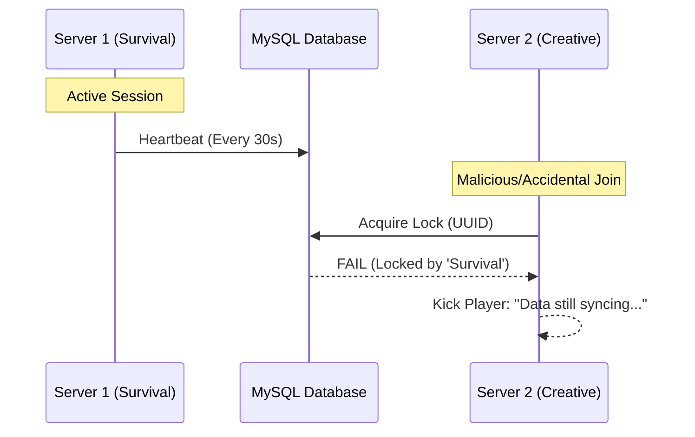
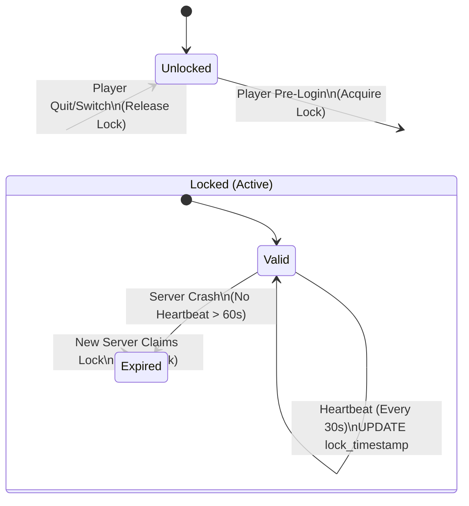

```mermaid
sequenceDiagram
    autonumber
    actor User
    participant P as Proxy (Velocity)
    participant S1 as Source Server
    participant DB as MySQL Database
    participant S2 as Destination Server

    User->>P: /server survival
    par Signal & Switch
        P->>S1: Plugin Message: "SaveAndRelease"
        P->>S2: Connect User
    end

    rect rgb(35, 35, 35)
        Note over S1, DB: Async Save Process
        S1->>DB: UPDATE data... (Save)
        S1->>DB: UPDATE is_locked=0 (Release)
    end

    rect rgb(45, 20, 20)
        Note over S2, DB: Pre-Login Guard
        loop Polling Lock (Max 10s)
            S2->>DB: Attempt Acquire Lock (UPDATE ...)
            alt Lock Acquired
                DB-->>S2: Success
                Note over S2: Break Loop
            else Locked by S1
                DB-->>S2: Fail (Rows = 0)
                S2-->>S2: Sleep 500ms
            end
        end
    end

    S2->>DB: SELECT data (Load)
    DB-->>S2: Return Player Data
    S2-->>User: Join Successful
```

# HMT Sync


[](https://github.com/TitanSMP/HMTSync/releases)
[](https://hangar.papermc.io/HMLabs-Gaming/HMTSync)

HMT Sync is a robust, high-performance plugin for **PaperMC (Spigot)** servers and the **Velocity** proxy. It synchronizes player data across multiple Minecraft servers, ensuring a consistent experience by retaining health, hunger, experience, inventory, and more as players move between linked servers.

> Originally forked from *MC Data Bridge*, maintained for the HMT Network.

## Compatibility

- **Minecraft Version:** `26.3` (built against Paper `26.3.build.42-alpha`)
- **Java:** 25
- **Server Platforms:** PaperMC (or forks like Purpur), Spigot
- **Proxy Platform:** Velocity

Separate JARs are shipped for each platform:

| JAR | Platform |
| --- | --- |
| `hmt-sync-<version>-spigot.jar` | Paper / Spigot backends |
| `hmt-sync-<version>-velocity.jar` | Velocity proxy |

The backend and proxy JARs share the same codebase but contain platform-specific plugin metadata.

## Features

- **Proxy-Initiated Saves:** The proxy orchestrates the save process, ensuring a player's data is saved from their source server _before_ they connect to the destination server. This eliminates race conditions and prevents data loss during a server switch.
- **Fully Asynchronous:** All database operations run on separate threads, so the server's main thread is never blocked — no lag even if the database is slow.
- **Robust Locking Mechanism:** A database-level locking mechanism with version-based fencing and an automatic timeout prevents data corruption and ensures only one server can write a player's data at a time.
- **Version-Independent Item Serialization:** Inventories are serialized using Minecraft's built-in Base64 methods, preventing data loss across Minecraft updates.
- **Redis Hybrid Cache (optional):** A short-lived Redis mirror of the player payload lets a server hand data back without an immediate SQL read. SQL stays authoritative; locking and fencing never move to Redis.
- **Cross-Server Player Data Sync:**
  - Health & max-health attributes
  - Food level & saturation
  - Experience (total XP, current XP, level)
  - Inventory, armor & ender chest contents
  - Active potion effects
  - Advancements, recipes & statistics
  - Flight & gamemode, including gamemode-specific inventories
  - Persistent data container (PDC) values
  - Maps (cross-server map synchronization)
  - Companions / tamed pets
- **Economy & Playtime Bridges (optional):** Sync balances (Vault + an economy provider) and playtime (EssentialsX) across the network.
- **Resilient Connection Pooling:** Uses HikariCP with optimized settings to survive network issues and database restarts.
- **MySQL or SQLite:** Use a shared MySQL/MariaDB database for a network, or a local SQLite file.
- **Granular Sync Control:** Enable or disable synchronization per data type via `config.yml`.
- **Server/World Blacklist:** Prevent synchronization on specific servers or worlds.
- **Admin Tools:** In-game inspector GUI (read-only and edit modes), manual lock release, and data migration commands.
- **Security:** SHA-256 data integrity verification and salted HMAC identity hashing with legacy fallback.
- **Metrics:** Optional embedded Prometheus metrics exporter.

## Installation

### From a release

1. **Download** the matching JAR from [GitHub Releases](https://github.com/TitanSMP/HMTSync/releases) or [Hangar](https://hangar.papermc.io/HMLabs-Gaming/HMTSync).
2. **Backends:** Copy `hmt-sync-<version>-spigot.jar` into the `plugins/` folder of **each Paper/Spigot server**.
3. **Proxy:** Copy `hmt-sync-<version>-velocity.jar` into the `plugins/` folder of your **Velocity proxy**.
4. **Configure** `config.yml` on each backend (see below), then restart the proxy and all servers.

### Building from source

Requires **JDK 25** and **Maven 3.9+**.

```bash
# Backend (Paper/Spigot)
mvn clean package -Pspigot
# -> target/hmt-sync-<version>-spigot.jar

# Proxy (Velocity)
mvn clean package -Pvelocity
# -> target/hmt-sync-<version>-velocity.jar
```

Development builds end in `-SNAPSHOT`; release builds use the plain version number.

---

## 🛠 Technical Deep Dive

HMT Sync takes a **Security-First** approach to player state. Unlike plugins that rely on simple "Save-on-Quit", it uses a proxy-orchestrated handshake to eliminate data loss and duplication exploits.

### 1. The Secure Handshake (Happy Path)

The proxy acts as coordinator. It ensures the source server has committed data to the database and released its lock before the destination server is allowed to request it.



### 2. Anti-Duplication & Race Condition Protection

A database-level lock prevents the "double-login" exploit. If a player somehow exists on two servers at once, the second server is denied access until the first safely disconnects.



### 3. Crash Resilience & Auto-Recovery

If a backend crashes, a player's lock might remain stuck. HMT Sync handles this via a configurable `lock-timeout` (default: 60s), so players aren't permanently locked out.



---

## Configuration

A `config.yml` file is generated in `plugins/HMTSync/` on each backend after the first run. You must set your database credentials and a **unique `server-id` per server**. The proxy does not need a `server-id`.

```yaml
database:
  # "mysql" (MySQL/MariaDB) or "sqlite" (local file)
  type: mysql
  host: localhost
  port: 3306
  database: minecraft
  username: user
  password: password
  sqlite-file: "player_data.db"

  # "json" (Base64 NBT, compatible) or "binary" (compressed, recommended for production)
  serialization-format: "json"

  properties:
    useSSL: false
    allowPublicKeyRetrieval: true

  pool-settings:
    maximum-pool-size: 10
    minimum-idle: 10
    max-lifetime: 1800000
    connection-timeout: 5000
    idle-timeout: 600000

# Verbose console logging.
debug: false

# A unique name for this server. CRITICAL for data locking.
server-id: "default-server"

# Prefix for the player_data table. Leave empty for default.
table-prefix: ""

# Milliseconds before a data lock is considered expired.
lock-timeout: 60000

# Heartbeat interval (seconds) for lock updates.
lock-heartbeat-seconds: 30

# Granular sync toggles.
sync-data:
  health: true
  food-level: true
  experience: true
  inventory: true
  armor: true
  potion-effects: true
  ender-chest: false
  location: false
  advancements: false
  statistics: false
  pdc: false
  flight-gamemode: false
  companions: false
  maps: false
  separate-gamemode-inventories: false
  economy: false
  playtime: false

# Skip synchronization on these servers/worlds.
sync-blacklist:
  servers:
    - "example-blacklisted-server"
  worlds:
    - "example_world_nether"

# Optional Redis read-through cache (SQL stays authoritative).
redis:
  enabled: false
  host: localhost
  port: 6379
  password: ""
  timeout-ms: 2000
  cache-duration-seconds: 300
  storage-strategy: "mysql-only" # or "redis-mysql-hybrid"

# Security.
security:
  log-uuid-mismatches: true
  verify-data-integrity: true
  seed: "change-me-to-a-long-random-string"

# Identity handling.
identity:
  mode: PREMIUM # or HYBRID
  auto-migrate-fastlogin: false
  auto-migrate-authme: false

# Companion / pet transfer.
companions:
  scan-radius: 32
  mode: "follow" # follow | return | untracked

# Optional Prometheus metrics exporter.
metrics:
  enabled: false
  port: 8080
  path: "/metrics"
```

Key options:

- **`database.*`** — MySQL/MariaDB or SQLite connection, serialization format, HikariCP pool and JDBC tuning.
- **`server-id` (required)** — must be unique for every backend sharing the database.
- **`lock-timeout`** — time before a stale lock is stolen from a crashed server.
- **`sync-data.*`** — enable/disable individual data components. Newer features (`ender-chest`, `advancements`, `statistics`, `maps`, `economy`, `playtime`, …) default to off.
- **`sync-blacklist`** — servers/worlds excluded from synchronization.
- **`redis`** — optional hybrid cache; the fence/lock always stays in SQL.
- **`security`** — change `seed` to a long random string; it salts identity hashes and checksums.
- **`identity`** — `PREMIUM` keeps UUIDs stable; `HYBRID` allows Cracked→Premium migrations (optionally automated via FastLogin/AuthMe).

See [REDIS_INTEGRATION_GUIDE.md](REDIS_INTEGRATION_GUIDE.md) for Redis details and [BUILD_GUIDE.md](BUILD_GUIDE.md) for build troubleshooting.

## Commands

Backends (permissions in parentheses):

- `/hmtsync unlock <player>` — manually release a data lock (`hmtsync.admin`)
- `/hmtsync inspect <player> [inventory|enderchest] [--edit]` — open the data inspector GUI (`hmtsync.inspect`; editing needs `hmtsync.inspect.edit`)
- `/hmtsync invsee <player> [--edit]` — open a player's inventory (`hmtsync.inspect`)
- `/hmtsync endersee <player> [--edit]` — open a player's ender chest (`hmtsync.inspect`)
- `/hmtsync migrate <source> <target>` — migrate data between identities (`hmtsync.admin`)
- `/hmtsync-debug <status|test-economy|test-playtime|test-enderchest>` — diagnostics (`hmtsync.admin`)

Proxy (Velocity):

- `/hmtsync unlock <player>` — release a lock from the proxy

## Permissions

| Permission | Default | Description |
| --- | --- | --- |
| `hmtsync.admin` | op | Admin commands and debug tools |
| `hmtsync.inspect` | op | View-only inspection of player data and inventories |
| `hmtsync.inspect.edit` | op | Interactive editing of player data and inventories |

## Important Notes

- **Database Requirement:** A shared **MySQL/MariaDB** database is recommended for a network; SQLite is supported for local use.
- **Security Best Practice:** Create a dedicated MySQL user with only `SELECT`, `INSERT`, `UPDATE`, `CREATE`, and `ALTER` on the target database, and set a strong `security.seed`.
- **Connectivity & Firewalls:** Backends and the proxy must be able to reach the database host/port.
- **Automatic Schema:** The plugin creates and updates the `player_data` table automatically. The schema includes `uuid`, `data`, `is_locked`, `locking_server`, `lock_timestamp`, `lock_version`, and `last_updated`.
